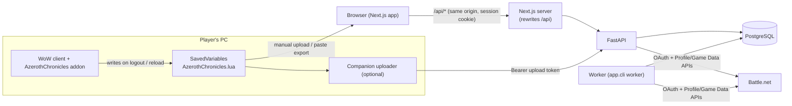
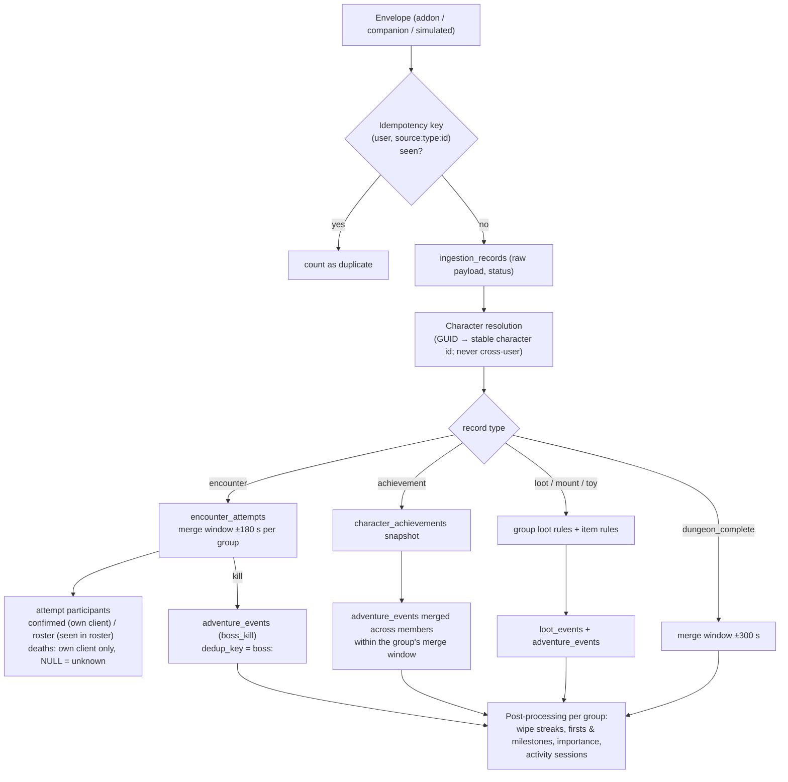

# Architecture

* The browser only talks to the Next.js origin; `/api/*` is rewritten to FastAPI. The session cookie is
  first-party, `HttpOnly`, `SameSite=Lax`. No secret ever reaches the client bundle.
* The worker periodically runs Battle.net syncs and recomputes open award periods. At this scale no Redis
  or queue is needed; manual syncs run as FastAPI background tasks and are tracked in `sync_jobs`.

## Event pipeline: raw → canonical

Key properties:

* **Raw records are immutable** (`ingestion_records`) with status `normalized | ignored | rejected` and the
  canonical rows they produced (`canonical_refs`), so data can be audited and reprocessed.
* **Multiple reporters, one event.** Two members uploading the same pull produce one `encounter_attempt`
  (`reporter_count = 2`) and one timeline event. A Postgres advisory lock per group serializes merging.
* **Firsts are recomputed, not inferred at insert time**, so importing old data later still yields the
  correct "first kill" / "first raid boss together" / "first legendary" highlights.
* **Participation is evidence-based**: `confirmed` (member's own addon or Battle.net), `roster` (seen in a
  group-mate's roster at the time and matched to a known character of a group member), `claimed`
  (manual). Unknown roster names are never attributed.
* **Backfill vs live** for Battle.net achievements is described in [blizzard-integration.md](blizzard-integration.md).
* **Game artwork** (item/achievement icons, boss portraits, dungeon art) is resolved asynchronously after
  ingestion from Blizzard's Game Data API; only Blizzard render-CDN URLs are stored. See
  [blizzard-integration.md](blizzard-integration.md#game-artwork-icons-boss-portraits-dungeon-art).
* **Importance** (0–100, `app/services/importance.py`) decides default timeline visibility only; nothing
  below the threshold is deleted, and the UI shows how many minor events are hidden.

## Database schema

All timestamps are `timestamptz` in UTC. UUID primary keys for user-facing rows; game catalog tables use
the game's numeric ids. Migration: `backend/alembic/versions/0001_initial_schema.py`.

```mermaid
erDiagram
  users ||--o{ user_sessions : has
  users ||--o{ api_tokens : has
  users ||--o{ external_accounts : links
  external_accounts ||--o| integration_credentials : "encrypted tokens"
  users ||--o{ oauth_states : pending
  users ||--o{ group_memberships : joins
  groups ||--o{ group_memberships : has
  groups ||--o{ group_invites : issues
  groups ||--o{ group_item_rules : configures
  users ||--o{ characters : owns
  characters ||--o{ character_identity_history : "renames / transfers"
  characters ||--o{ character_achievements : snapshot
  achievements ||--o{ character_achievements : ""
  groups ||--o{ adventure_events : timeline
  adventure_events ||--o{ event_participants : ""
  users ||--o{ event_participants : ""
  characters |o--o{ event_participants : ""
  adventure_events ||--o{ event_comments : ""
  adventure_events ||--o{ event_reactions : ""
  adventure_events ||--o{ event_media : screenshots
  adventure_events ||--o{ event_favorites : ""
  adventure_events }o--o| achievements : ""
  adventure_events }o--o| encounters : ""
  adventure_events }o--o| items : ""
  game_instances ||--o{ encounters : "dungeon / raid"
  game_instances |o--o{ adventure_events : artwork
  groups ||--o{ encounter_attempts : pulls
  encounters ||--o{ encounter_attempts : ""
  encounter_attempts ||--o{ encounter_attempt_participants : ""
  encounter_attempts |o--o| adventure_events : "kill event"
  groups ||--o{ loot_events : museum
  items |o--o{ loot_events : ""
  loot_events |o--o| adventure_events : ""
  groups ||--o{ activity_sessions : derived
  award_definitions ||--o{ award_results : ""
  groups ||--o{ award_results : ""
  award_definitions ||--o{ award_nominations : ""
  award_nominations ||--o{ award_votes : ""
  users ||--o{ sync_sources : "status per source"
  users ||--o{ sync_jobs : runs
  sync_jobs ||--o{ ingestion_records : produced
```

Notable constraints and indexes:

| Table | Constraint / index | Purpose |
|---|---|---|
| `adventure_events` | `UNIQUE(group_id, dedup_key)`, `(group_id, occurred_at)`, `(group_id, event_type)` | cross-source dedup, timeline paging |
| `encounter_attempts` | `UNIQUE(group_id, dedup_key)`, `(group_id, encounter_id, difficulty_id)` | one row per pull |
| `ingestion_records` | `UNIQUE(user_id, idempotency_key)` | idempotent uploads |
| `characters` | `UNIQUE(region, blizzard_character_id)`, `UNIQUE(player_guid)` | stable identity across renames |
| `character_achievements` | `UNIQUE(character_id, achievement_id)` | snapshot diffing |
| `event_participants` | `UNIQUE(event_id, user_id)` | one participation per member |
| `award_results` | `UNIQUE(group_id, award_key, period_type, period_start)` | reproducible upserts |
| `loot_events` | `UNIQUE(group_id, dedup_key)` | no double museum entries |

Group configuration lives in `groups.settings` (JSONB) and is validated by `app/services/group_settings.py`.

## Security model

* Argon2id password hashing; opaque random session tokens stored only as SHA-256 hashes; 14-day expiry.
* Every group route resolves the group **through the caller's membership**; non-members get `404`
  (no existence leak). Roles: owner > admin > member, enforced server-side.
* CSRF: cookie-authenticated writes require the `X-AC-Client: web` header (impossible cross-site without a
  CORS preflight, which is never granted) and an allowed `Origin`.
* Upload tokens (`act_…`) are hashed, revocable, and accepted **only** on `/api/ingest/*`.
* Battle.net tokens are Fernet-encrypted at rest; OAuth `state` is random, hashed, single-use, user-bound,
  10-minute TTL. We never ask for Battle.net passwords.
* Screenshots: size limit, Pillow verification, re-encoding (strips EXIF/GPS and polyglots), served only to
  group members with `nosniff`.
* SavedVariables are **parsed, never executed** (`app/services/lua_savedvariables.py`).
* Invites expire, can be usage-limited and revoked. Login/registration are rate-limited.
